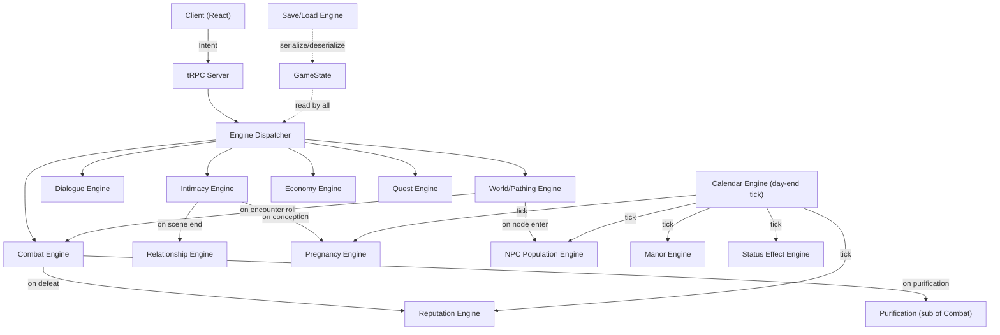

# Ojisan in Another World — Deep Engine & Requirements Analysis

**Analysis version:** 1.3 (updated 2026-09-01)
**PRD version:** 1.4

## Executive Summary

The [requirements.md](./requirements.md) (v1.4) defines **20 engines**, 7 sections of core architecture, and **10 distinct UI views**. The [spawn-engine/](./spawn-engine/) directory contains **15 TypeScript files** that implement a deep **NPC Procedural Generation + Intimacy Encounter** system. This covers the **NPC Population & Simulation Engine (§4.10)**, the **Procedural Content Generation Engine (§4.20)**, and significant portions of the **Intimacy Engine (§4.3)** and **Pregnancy Engine (§4.16)**.

**Of the 20 engines described in the requirements, only ~3–4 have any actual code. The remaining 16–17 engines exist only as specifications.** Below is a detailed per-engine audit.

**Frontend status:** UI stub files exist locally for the Phase UI tasks. However, the PRD §4.21.3 view list was substantially expanded in v1.4 (10 views, up from 6), and the Overworld view was redesigned as a 30×30 tile-grid spatial canvas with a merged Manor context panel. The current `OverworldView.tsx` and `ManorTab.tsx` stubs are superseded by this new design. Several new views were added with no stubs yet. See §5 below for the full frontend delta.

> **Code quality note:** The existing code has been substantially patched since the initial audit. Most of the originally reported bugs (§3) have been resolved. Outstanding issues are called out inline.

---

## Table of Contents

1. [Engine Status Matrix](#1-engine-status-matrix)
2. [Per-Engine Deep Analysis](#2-per-engine-deep-analysis)
3. [Cross-Cutting Code Issues](#3-cross-cutting-code-issues)
4. [Engine Orchestration Model](#4-engine-orchestration-model)

---

## 1. Engine Status Matrix

| # | Engine | Status | Has Code? | Key Missing Pieces |
|---|--------|--------|-----------|-------------------|
| 4.1 | Character Progression | ❌ Spec only | No | Leveling, stat formulas, skill point pools |
| 4.2 | Combat | ❌ Spec only | No | Full implementation; initiative, damage, AI, flee |
| 4.2.1 | Enemy/Monster Spawn | ❌ Spec only | No | Enemy character schema, monster type definitions, scaling algorithm |
| 4.3 | Intimacy | 🟡 Partial | Yes (spawn-engine/patches.ts, spawn-engine/dynamicState.ts) | Scene state machine, position/action catalog, TEC check, satisfaction calc |
| 4.4 | Relationship (Player-NPC) | ❌ Spec only | No | Trust/Love matrix, 16-cell grid, move-in check, diminishing returns, playerBondType setter |
| 4.4a | NPC-NPC Social System | ✅ Implemented | Yes (npcSocialEngine.ts) | Wiring to calendarEngine step 9; mockGameState update |
| 4.5 | Reputation | ❌ Spec only | No | Region scoring, decay, bounty formula, event table |
| 4.6 | Quest | ❌ Spec only | No | QuestDef schema, objective completion, quest log |
| 4.7 | Calendar & Time | ❌ Spec only | No | Phase system, fatigue table, day-end tick sequence |
| 4.8 | Economy & Inventory | ❌ Spec only | No | ItemDef schema, bag slots, sell formula, gifting |
| 4.9 | Crafting & Equipment | ❌ Spec only | No | Recipe schema, upgrade system, failure rates |
| 4.10 | NPC Population & Simulation | ✅ Implemented | Yes (spawn-engine/spawnEngine.ts + supporting files) | Name pools, hasBeenIntroduced, schedule system, 3-day refresh logic |
| 4.11 | Dialogue | ❌ Spec only | No | DialogueNode schema, condition evaluator, flag system |
| 4.12 | Skills & Abilities | ❌ Spec only | No | SkillDef schema, tree structure, CPW consumption |
| 4.13 | Status Effects | ❌ Spec only | No | StatusEffectDef, per-turn tick, stacking |
| 4.14 | Achievements | ❌ Spec only | No | Achievement schema, condition evaluation, reward granting |
| 4.15 | World Map & Travel | ❌ Spec only | No | Graph structure, Dijkstra, encounter table, fast travel |
| 4.16 | Pregnancy & Offspring | 🟡 Partial | Yes (spawn-engine/bodyTypes.ts pregnancy stages) | Gestation tracking, birth logic, conception check, offspring stat gen |
| 4.17 | Manor & Passive Gen | ❌ Spec only | No | Tier table, construction timer, suite assignment, passive gen |
| 4.18 | Save/Load & Migration | ❌ Spec only | No | JSON serialization, Set↔Array conversion, versioning |
| 4.19 | Contact & Profile | ❌ Spec only | No | Contact list assembly, profile view aggregation |
| 4.20 | Procedural Content Gen | ✅ Implemented | Yes (spawn-engine/spawnEngine.ts, raceProfiles.ts, etc.) | Name pools, enemy stat scaling |

---

## 2. Per-Engine Deep Analysis

---

### 4.1 Character Progression Engine

**Status: ❌ Spec only**

**What the PRD says:**
- Combat attributes: STR, AGI, WIS, DEF, LCK
- Erotic attributes: Sensitivity, Technique, Virility (player only)
- Leveling via `newStat = baseStat + (level - 1) × roleMultiplier × baseStat × 0.1`
- Two skill trees: Battle (BP) and Ardor (AP)
- Active skills cost CPW; passive always active

**What's missing:**
- No `PlayerState` interface (HP, Stamina, CPW pools with current/max)
- No level/XP tracking
- No skill tree data structure or point pool
- No class/role definitions with multiplier tables
- No BP/AP award on level-up formula

---

### 4.2 Combat Engine

**Status: ❌ Spec only**

**What the PRD now specifies:**
- Initiative = `AGI + d10`, ties broken by LCK; order fixed for fight
- Damage = `weaponPower × (ATK STR / 10) - DEF × 0.5`, min 1
- Crit chance = `LCK / 200`, multiplier 1.75×
- Dodge = `AGI / 300`, max 33%
- Flee chance = `(playerAGI - avgEnemyAGI) / 100 + 0.3`, clamped 10%–80%
- Purification arousal gain = `skillPower × (TEC / 10) - miasmaRes × 0.3`, min 1
- AI patterns: Aggressive, Defensive, SupportCaster, BossScripted (with HP-threshold phases)
- Miasma/Mana Reserve does not regen mid-fight

**What's missing from code:**
- Everything — no `CombatEncounter`, `CombatTurn`, `EnemyAIPattern`, or any combat resolution logic

**Recommendation:** Define `CombatState`, `CombatAction`, and `CombatResult` interfaces before building resolution logic. The AI decision trees should be strategy objects, not switch statements.

---

### 4.2.1 Enemy & Monster Spawn Engine

**Status: ❌ Spec only — NEW section**

**What the PRD specifies:**
- Enemies and monsters are characters in the same sense as NPCs — they use the same spawn engine schema plus enemy-specific overlay fields: `aiPattern`, `miasmaReserve`/`manaReserve`, `lootTable`, `purificationReward`, `defeatOutcomeOptions`, `isHumanoidForm`, `monsterSex`
- Monster types: Beast, Undead, Elemental, Demon, Miasma-Corrupted
- Humanoid enemies: full NPC spawn profile (via spawnEngine.ts) + combat stat overlay
- Scaling: `enemyBaseStat = monsterTypeBase × regionTierMultiplier` (Tier 1–5: 1.0×, 1.4×, 1.9×, 2.5×, 3.2×)
- Boss enemies: hand-crafted, defined in static data files

**What's missing from code:**
- No `EnemyCharacter` interface extending `Character` with enemy fields
- No `MonsterTypeDef` static data
- No enemy spawn function (wraps spawnEngine + overlays combat stats)
- No `LootTable` or `DefeatOutcome` schema
- No boss profile data files
- The NPC spawn engine (spawnEngine.ts) is reusable as-is for humanoid enemies — this is intentional and correct

**Design note:** The existing spawn engine in `spawn-engine/` correctly serves as the base for humanoid enemy generation. Monster-type enemies (Beast, Undead, etc.) will still use the character schema but may have simplified or fixed physical profiles rather than fully procedural ones. The key addition is the combat stat overlay layer.

---

### 4.3 Intimacy Engine

**Status: 🟡 Partial**

**What actually exists:**
- `spawn-engine/patches.ts`: `resolveEncounterTurn()` and `resolvePostEncounter()` — per-turn physiology/psychology updaters
- Pleasure tracking (Patch 1), wetness sync (Patch 2), vagina type update (Patch 3), wetness baseline (Patch 4), orgasm acquisition (Patch 5), sexual lean shifts (Patch 6), resistance decay (Patch 7), stamina system (Patch 8), subspace (Patch 9), afterglow (Patch 10), kink acquisition (Patch 11)
- `spawn-engine/dynamicState.ts`: `PhysicalState`, `MentalState`, `RelationshipState`, `PregnancyBodyState`

**What's missing:**
- No `IntimacyScene` state machine
- No position catalog (`IntimacyPosition` schema)
- No action catalog (`IntimacyAction` schema with TEC requirement and penetration target declaration)
- No `occupiedPenetrationTargets` tracking
- No TEC check implementation
- No satisfaction score calculation
- No sexual response fragment repository or selection system
- No scene start/end orchestration wrapping the per-turn resolver

**Recommendation:** Create `src/engines/intimacyEngine.ts` with `IntimacyScene` state machine; position and action catalogs live in `src/data/` static data files.

---

### 4.4 Relationship Engine (Player-NPC)

**Status: ❌ Spec only**

**What the PRD specifies:**
- Trust and Love each -100 to +100 (player-facing scalars on `NpcCharacter`)
- Band thresholds: Low (-100 to -25), Neutral (-25 to 25), High (25 to 75), VeryHigh (75 to 100)
- 16-cell (Trust × Love) matrix → `RelationshipStatus` label + available interactions
- Gift: +10 Trust / +15 Love; Flirt/Touch: diminishing returns, max 3/day
- Move-in: Trust ≥ 60 AND Love ≥ 60 (or per-character override)
- `playerBondType?` on `NpcCharacter` records the bond with the player; Devoted/Owned/Broken/Corrupted/Submissive are player-exclusive (enforced by npcSocialEngine)

**What exists:** Bond type resolution in `spawn-engine/dynamicState.ts` tracks encounter-based bonds — this is the *intimacy bond system*, not the Trust/Love relationship matrix. They are separate systems. Trust/Love fields and `playerBondType` are defined on `NpcCharacter` in `gameState.ts`.

**What's missing from code:**
- No 16-cell matrix lookup implementation
- No diminishing returns counter logic
- No move-in eligibility check implementation
- No gifting mechanic implementation
- No `relationshipEngine` setter for `playerBondType` when a player-exclusive bond is established

---

### 4.4a NPC-NPC Social System

**Status: ✅ Implemented**

**What exists (`src/engines/npcSocialEngine.ts`):**
- Three-part subset selection (personalityScore + relationshipPull + locationBonus; threshold 25)
- Weighted candidate scoring with stranger-gate (open+extraverted NPCs can cold-connect)
- Four interaction types: Talk, Flirt, Intimate, Conflict — selected by priority chain per pair
- Full delta resolvers for all four types; intimate tick is 4 loops × 5 random actions (flat stat update)
- Bond evolution ladder: Stranger → Acquaintance → Familiar → Friend → CloseFriend → Crush → Attachment → Dependent → Love → Devoted; branching to Obsession, HateLove, PureHate, Submissive, Transactional
- `PLAYER_EXCLUSIVE_BONDS` gate in `evolveBond()` — checks `npc.playerBondType`; blocks NPC from evolving into the same exclusive type with another NPC
- Bond cap enforcement per BondType (collision → downgrade weakest to Acquaintance)
- 30-day decay + 20-slot cap enforcement in `runDecayAndCapEnforcement()`
- Immutable write-back via `applyInteractionLog()`
- `runNpcSocialTick()` is the day-end entry point

**What's still pending:**
- `calendarEngine.runDayEndTick()` step 9 is a comment stub — needs actual call to `runNpcSocialTick()`
- `mockGameState.ts` NPC entries need `npcRelationships: []`, `playerBondType: undefined`, `npcInteractionLog: []` added

---

### 4.5 Reputation Engine

**Status: ❌ Spec only**

**PRD now specifies:** Tier labels, decay formula (5 pts/day on negatives), bounty formula (`abs(score) × 2 gold`), sample event table.

**What's missing from code:** Everything.

---

### 4.6 Quest Engine

**Status: ❌ Spec only**

**PRD now specifies:** `QuestDef`, `ObjectiveDef`, `QuestReward` schemas; cooldowns in in-game days (resolves the previous hours/phases mismatch).

**What's missing from code:** Everything.

---

### 4.7 Calendar & Time Engine

**Status: ❌ Spec only**

**PRD now specifies:** Which player actions count toward phase advance; direct-advance events; full fatigue penalty table; day-end tick sequence (in §2.2).

**What's missing from code:** Everything.

---

### 4.8 Economy & Inventory Engine

**Status: ❌ Spec only**

**PRD now specifies:** `ItemDef` schema, sell price formula, inventory slot expansion via Manor tiers.

**What's missing from code:** Everything.

---

### 4.9 Crafting & Equipment Upgrade Engine

**Status: ❌ Spec only**

**PRD now specifies:** Upgrade stat bonus per tier (+1 per tier to all item stats), failure rates by upgrade level and method (Forge vs Alchemy Lab), no item destruction on failure.

**What's missing from code:** Everything.

---

### 4.10 NPC Population & Simulation Engine

**Status: ✅ Implemented (core generation)**

**What exists:** Full character generation pipeline in `spawn-engine/spawnEngine.ts` + supporting files. Race-aware weighted random selection, age-body profile system, pregnancy stage overlays, attractiveness bias, population configs (STANDARD, FANTASY_HEAVY), batch spawn function.

**What's missing:**
- No NPC name generation (name pools undefined)
- No `hasBeenIntroduced` flag or individuation flow
- No Contact List cap enforcement
- No service NPC fixed roster
- No `NpcScheduleDef` or schedule system
- No 3-day population refresh cycle logic
- No location assignment or per-location population range
- `genderRatio` is a flat parameter; PRD requires per-class `genderWeight`

---

### 4.11 Dialogue Engine

**Status: ❌ Spec only**

**PRD now specifies:** Full `DialogueNode`, `DialogueChoice`, `DialogueCondition` schemas with 6 condition types.

**What's missing from code:** Everything.

---

### 4.12 Skills & Abilities Engine

**Status: ❌ Spec only**

**PRD now specifies:** `SkillDef` schema with tree, point cost, prerequisites, CPW cost, and typed `SkillEffect` union.

**What's missing from code:** Everything.

---

### 4.13 Status Effects Engine

**Status: ❌ Spec only**

**PRD now specifies:** `StatusEffectDef` and `ActiveStatusEffect` schemas.

**What's missing from code:** Everything.

---

### 4.14 Achievements Engine

**Status: ❌ Spec only — PRD is sparse**

**What's missing from PRD:** Achievement definition schema, condition types, full list of achievements.

**What's missing from code:** Everything.

---

### 4.15 World Map & Travel Engine

**Status: ❌ Spec only**

**PRD now specifies:** Encounter chance by phase (Morning 10% → Midnight 50%), fast travel cost (5 gold × region crossings), `WorldNode` schema with `isSafe` and `monsterProfileId`.

**What's missing from code:** Everything — graph structure, Dijkstra, encounter rolls, fast travel, `RegionMonsterProfile`.

---

### 4.16 Pregnancy & Offspring Engine

**Status: 🟡 Partial**

**PRD now specifies (resolving prior contradiction):** Gestation = **12 in-game weeks**; stage-to-week mapping defined; conception check formula (`fertilityRating / 100`); offspring stat averaging with ±10% variance; alignment roll (34/33/33).

**What exists:** `PREGNANCY_STAGE_OVERRIDES` in `spawn-engine/bodyTypes.ts` with body modification data per trimester; `applyAgeAndPregnancyInOrder` in `spawn-engine/ageBodyProfile.ts`.

**What's missing:**
- No `pregnancyWeek` increment at day-end
- No birth trigger logic
- No conception check function
- No offspring stat generation
- No alignment roll
- `cycleDay` and `fertile` flags exist in code but nothing consumes them

---

### 4.17 Manor & Passive Generation Engine

**Status: ❌ Spec only**

**PRD now specifies:** Full 6-tier feature unlock table.

**What's missing from code:** Everything.

---

### 4.18 Save/Load & Migration Engine

**Status: ❌ Spec only**

**Key technical issue (still unresolved in code):** `Set<T>` is used in `SexualPsychology.acquiredKinks`, `OrgasmProfile.acquiredTypes`, `SexualActFlags.orgasmTypesExperienced`, `SexualActFlags.kinksExperienced`. `JSON.stringify` silently serializes these as `{}`. Custom JSON replacer/reviver required before save/load can function.

---

### 4.19 Contact & Profile Engine

**Status: ❌ Spec only**

**What's missing from code:** Everything.

---

### 4.20 Procedural Content Generation Engine

**Status: ✅ Implemented (NPC appearance)**

**PRD now specifies:** Enemy stat scaling algorithm (`enemyBaseStat = monsterTypeBase × regionTierMultiplier` with tier 1–5 multipliers).

**What's missing:**
- NPC name pools (per race, gendered)
- Enemy stat scaling implementation
- `MonsterTypeDef` static base stats

---

## 3. Cross-Cutting Code Issues

### 3.1 RESOLVED — Previously reported bugs

The following bugs from the initial analysis have been fixed in the current codebase:

| Bug | File | Status |
|-----|------|--------|
| Double `return {}` syntax error in `createInitialDynamicState` | spawn-engine/dynamicState.ts | ✅ Fixed |
| Duplicate imports (RACE_PROFILES, FEMALE_BODY_TYPES, etc.) | spawn-engine/spawnEngine.ts | ✅ Fixed |
| Circular self-import in spawnEngine | spawn-engine/spawnEngine.ts | ✅ Fixed |
| Duplicate `clamp`, `cupSizeToIndex`, `cupSizeFromIndex` functions | spawn-engine/ageBodyProfile.ts | ✅ Fixed |
| Missing `CockType` import | spawn-engine/physicalCore.ts | ✅ Fixed |
| Missing imports in personalityExpansion.ts | spawn-engine/personalityExpansion.ts | ✅ Fixed |
| `require()` mixed with ES imports (`deriveCockTypesFromTexture`) | spawn-engine/spawnEngine.ts → spawn-engine/patches.ts | ✅ Fixed — moved to patches.ts as `deriveCockTypesFromRace` |
| Missing `RACE_PROFILE_EXTENSIONS` reference | spawn-engine/spawnEngine.ts | ✅ Fixed — uses `RACE_PROFILES[race]` directly |
| `generateBackground` signature mismatch (3 vs 4 args) | spawn-engine/spawnEngine.ts | ✅ Fixed |
| `raceProfile` out of scope in `generateMalePhysicalDetail` | spawn-engine/spawnEngine.ts | ✅ Fixed — `raceProfile` now passed as parameter |
| `createEmptyRelationshipActFlags` vs `createEmptyActFlagsV2` | spawn-engine/dynamicState.ts | ✅ Fixed — `createEmptyRelationshipActFlags` defined locally |

### 3.2 OUTSTANDING — Set<T> JSON Serialization

`Set<T>` is used in multiple interfaces and is **not JSON-serializable**. `JSON.stringify` silently emits `{}` for any Set. This will cause silent data loss when save/load is implemented.

Affected fields:
- `spawn-engine/psychologyCore.ts` → `SexualPsychology.acquiredKinks: Set<Kink>`
- `spawn-engine/sexualPhysiology.ts` → `OrgasmProfile.acquiredTypes: Set<OrgasmType>`
- `spawn-engine/historyProfile.ts` → `SexualActFlags.orgasmTypesExperienced: Set<OrgasmType>`
- `spawn-engine/historyProfile.ts` → `SexualActFlags.kinksExperienced: Set<Kink>`

**Fix options:**
1. Replace all `Set<T>` with `T[]` everywhere (simplest, loses Set uniqueness guarantee)
2. Add a custom JSON replacer/reviver that converts `Set → Array` on stringify and `Array → Set` on parse
3. Use a serialization library (e.g., `superjson`) that handles Sets natively

### 3.3 RESOLVED — `spawn-engine/index.ts` converted to barrel export

The original `Project/index.ts` dead test runner (with `greet()`) has been replaced with a proper barrel export that re-exports the full spawn engine public API. The test runner moved to `testSpawn.ts` at the repo root.

---

## 4. Engine Orchestration Model

The PRD (§2.2) now defines:
- The `GameState` root interface sketch
- The intent → engine routing table
- The day-end tick sequence

The following remains undefined and should be addressed before parallel engine development begins:

1. **No event bus** — How does one engine signal another? (e.g., combat end → reputation update → quest objective check). Options: direct function calls with explicit pipeline, or an event queue processed at end of each intent.
2. **No engine execution order spec** — When multiple engines chain (movement → encounter → combat), the pipeline must be unambiguous.
3. **No `GameState` full interface** — The PRD sketch is illustrative; a complete TypeScript interface needs to be defined before individual engines can be type-checked against it.

**Recommended next step:** Define the full `GameState` interface in `src/state/gameState.ts` (already created) as the first task before building any engine. All engines take `GameState` as input and return `GameState` as output (pure functions where possible).



---

## 5. Frontend View Delta (PRD v1.4 changes)

The PRD §4.21.3 was significantly expanded. The view count grew from 6 to 10, and one existing view (Overworld) was completely redesigned. This section tracks the delta between what stub files exist and what is now required.

### 5.1 View Status Matrix

| View | PRD section | Stub file exists? | Action required |
|------|-------------|-------------------|-----------------|
| Title Screen | §4.21.3 | ❌ No | New stub needed |
| HUD (persistent overlay) | §4.21.3 | ✅ `HudShell.tsx` | Update: add fatigue indicator, dynamic safety-tier border color glow |
| Unified Spatial Exploration (30×30 grid) | §4.21.3 | ⚠️ `OverworldView.tsx` (superseded) | Redesign: replace list-based layout with tile grid canvas + Inspector Lens sidebar; `ManorTab.tsx` merges into this view's Inspector Lens |
| Combat | §4.21.3 | ✅ `CombatView.tsx` | No change |
| Intimacy | §4.21.3 | ✅ `IntimacyView.tsx` | No change |
| Dialogue | §4.21.3 | ✅ `DialogueView.tsx` | No change |
| Menus overlay | §4.21.3 | ✅ `MenuShell.tsx` | Inventory, Skills, Quests retain as tabs; Contacts and Manor panels become standalone views (see below); Manor tab grays out in Unsafe zones |
| Exploration Encounter | §4.21.3 | ❌ No | New stub needed |
| Equipment Management | §4.21.3 | ❌ No | New stub needed |
| Skill Trees | §4.21.3 | ⚠️ `SkillsTab.tsx` (in menu) | Now a standalone full view, not a menu tab; the existing tab stub may be repurposed or replaced |
| Contacts & Detailed Profiles | §4.21.3 | ⚠️ `ContactsTab.tsx` (in menu) | Now a standalone full view with 3-tab deep scroller and action bar; the existing menu tab stub may be repurposed or replaced |
| Achievements | §4.21.3 | ❌ No | New stub needed |
| Defeat / Game Over | §4.21.3 | ❌ No | New stub needed |
| Character Creation | §4.21.3 | ❌ No | New stub needed |
| Profile (player/contact) | §4.21.3 | ❌ No | Pending design; stub needed when design is settled |

### 5.2 Unified Spatial Exploration — Architecture Notes

This is the most architecturally significant change. The PRD replaces the list-based Overworld view with a **30×30 tile grid canvas** that acts as the combined exploration and manor interface.

**Tile model:**
- 900 tile components in a square grid.
- **Static colliders:** Wall tiles defined as a series of adjacent disabled/filled tiles. Doors are empty tiles (player simply walks through).
- **Location shape:** Locations can be non-rectangular — tiles at the edges of the square are disabled/hidden to give the location its shape.
- **Occupant stacking:** A single tile can hold multiple entities simultaneously. Party companions overlap the player’s tile; other NPCs and monsters can also stack on any tile. The tile renders the player avatar on top and a stacked-entity counter badge (e.g. "+3") when multiple entities share it.
- **Layers:** Conceptually three layers per tile — floor/terrain, static objects (walls, obstacles), and occupants (player/NPC/monster sprites or badges).

**Inspector Lens sidebar (right panel):**
- Context changes based on the tile the player is standing on or hovering.
- Shows entity stack accordion (social actions for NPCs, combat/purify for monsters).
- Shows Manor workspace if player is on a base/manor node (replaces the old `ManorTab`).
- Phase advance / Sleep button with safety-tier-aware behavior.
- Context log: last 5 narrative lines.

**Safety tier visual indicators:**
- HUD border color: Gold = Fully Safe, Iron/grey = Humanoid Only, Crimson Pulse = Unsafe.
- Inspector sleep button: absolute rest (Safe), guarded time-step (Humanoid Only), high-risk camp warning (Unsafe).
- Menu Inventory and Manor tabs: restricted/grayed in Unsafe zones.

**Key implication for existing stubs:**
- `OverworldView.tsx` is superseded and should be replaced, not extended.
- `ManorTab.tsx` loses its tab slot in the menu; its content moves into the Inspector Lens sidebar.
- The 30×30 tile grid is a significant new data model: `TileMap` (static terrain + colliders), `TileOccupants` (runtime entity positions). Both must be defined in `GameState` or returned by the server alongside `GameState`.

### 5.3 New Reusable Components Required

The new views introduce component needs not covered by the existing primitives:

| Component | Required by | Purpose |
|-----------|-------------|----------|
| `TileGrid` | Spatial Exploration | 30×30 canvas; renders terrain, colliders, and occupant badges |
| `TileCell` | `TileGrid` | Single tile: terrain variant + occupant layer + interactable state |
| `InspectorLens` | Spatial Exploration | Right sidebar; context-switched on tile focus |
| `SafetyTierBadge` | HUD, Spatial Exploration | Visual tier token (Secure/Fortified/Perilous) |
| `FatigueIndicator` | HUD | 5-tier icon row |
| `OccupantBadge` | `TileCell` | Stacked entity counter with priority rendering (player on top) |
| `SkillTreePane` | Skill Trees view | Single skill tree map with node connectors and glow states |
| `NodeTooltip` | `SkillTreePane` | Hover tooltip: CPW cost, prereqs, active/passive, effect list |
| `AchievementTile` | Achievements view | Trophy tile with tier border, title token, locked/unlocked state |
| `CharacterCreationCard` | Character Creation | Class/origin card with skill preview |
| `StatAllocator` | Character Creation | Attribute row with +/− buttons and remaining-points counter |

### 5.4 TileMap State Model

The 30×30 grid requires new state that doesn’t fit cleanly in the existing `GameState` interfaces. Proposed additions:

```typescript
// New fields to add to WorldState (or returned alongside GameState by server)
interface TileMap {
  locationId:  string;              // which location this map represents
  tiles:       TileCell[][];        // [row][col], 30×30
  spawnPoints: Record<string, TileCoord>; // entity id → starting tile
}

interface TileCell {
  coord:        TileCoord;          // { row, col }
  terrain:      TileTerrainType;    // FLOOR | WALL | CHASM | DOOR | EMPTY_EDGE
  isPassable:   boolean;            // false for walls, chasms, edge-disabled tiles
  objectId?:    string;             // static interactive object on this tile
}

interface TileCoord { row: number; col: number; }
type TileTerrainType = 'FLOOR' | 'WALL' | 'CHASM' | 'DOOR' | 'EMPTY_EDGE';

// Runtime occupant positions (separate from TileMap, changes every move intent)
type OccupantPositions = Record<string, TileCoord>; // entity id → current coord
```

Location tile map definitions (terrain layout, walls, doors, disabled edges) live in static data in `src/data/worldGraph.ts` or a dedicated `src/data/tileMaps.ts`.

### 5.5 Menu Tab Roster Changes

With Skills and Contacts becoming standalone views, the menu tab bar changes:

| Old tabs | New tabs |
|----------|----------|
| Inventory | Inventory |
| Skills | Quests |
| Quests | (Skills is now a full view, accessed via hotbar or HUD button) |
| Contacts | (Contacts is now a full view, accessed via Contacts button) |
| Manor | (Manor context merges into Inspector Lens) |

This means `MenuShell.tsx` shrinks to 2 tabs (Inventory + Quests), and the Skills/Contacts/Manor entries move out. The `SkillsTab.tsx`, `ContactsTab.tsx`, and `ManorTab.tsx` stubs are either promoted to standalone view files or removed.
